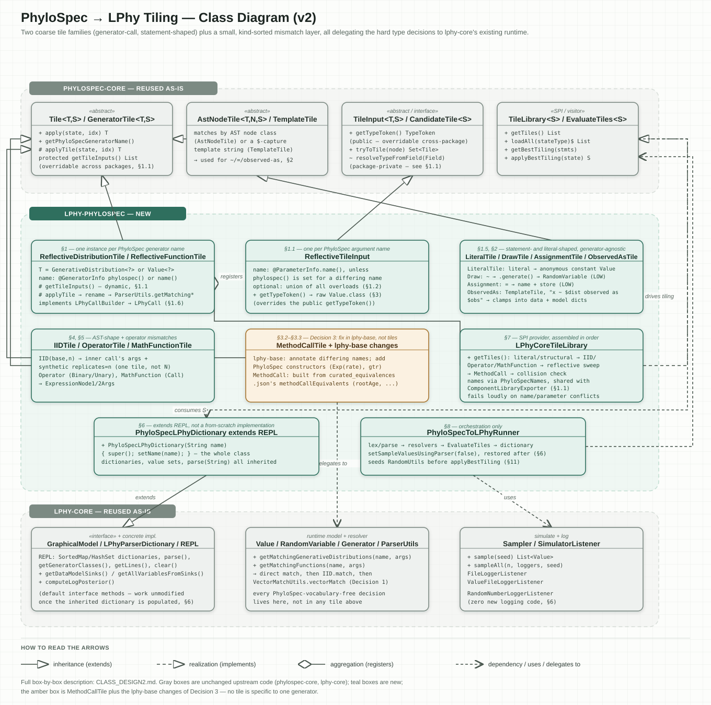
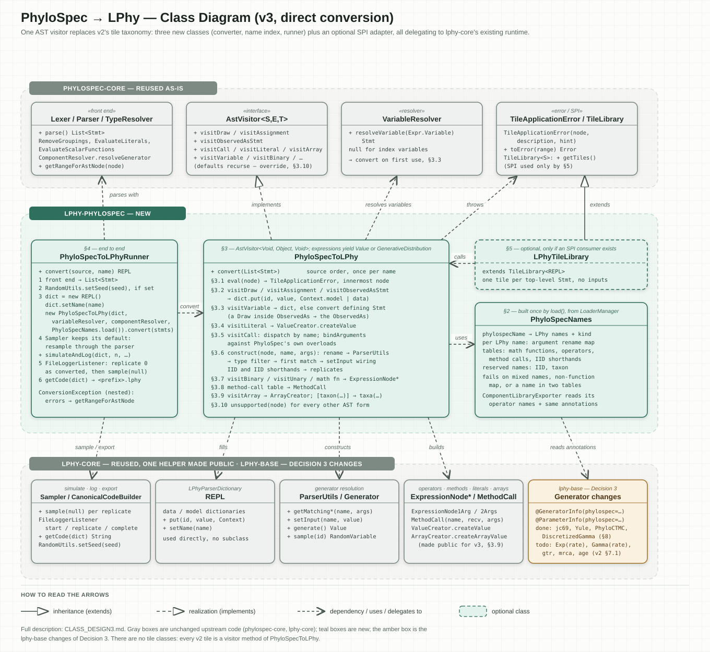

# Class design v2 vs. v3: tiled conversion vs. direct conversion

Both designs turn a PhyloSpec script into a live LPhy model that can be simulated, logged and
exported as `.lphy`. v2 ([`CLASS_DESIGN2.md`](CLASS_DESIGN2.md), class diagram
[`class-diagram2.svg`](class-diagram2.svg)) was never built; v3 ([`CLASS_DESIGN3.md`](CLASS_DESIGN3.md),
class diagram [`class-diagram3.svg`](class-diagram3.svg)) is the one implemented in
`lphy.phylospec.convert`. Both diagrams are reproduced [at the end](#class-diagrams-v2s-tile-families-vs-v3s-three-classes).

**In short:** v2 converts the script through `phylospec-core`'s tiling framework. v3 drops tiling and
converts the script with one visitor. LPhy has only one translation for each PhyloSpec construct, so
tiling has nothing to choose between.

## LPhy does not need tiling

PhyloSpec's BEAST 3 integration (`phylospec/integrations/beast3`) does use tiling: its runner calls
`EvaluateTiles`, and `BeastCoreTileLibrary` registers 79 tile classes.

| | BEAST 3 | LPhy |
|---|---|---|
| **Translations per construct** | Several, e.g. `LogNormalTile` vs. `LogNormalRealSpaceTile`, strict vs. relaxed clock | Exactly one: each PhyloSpec name maps to one LPhy generator (Decision 3) |
| **Type checks** | Decide which tile fits | Always pass: every input is a raw `Value` or `GenerativeDistribution` |
| **Extra choices** | Operators and loggers must be picked to suit the model | None: LPhy samples and logs any model the same way |
| **What tiling does** | Searches for the best translation | Would always return its only candidate |

Tiling is worth bringing back only if LPhy one day has several translations for the same PhyloSpec
construct that must be chosen by type.

## v3 replaces tiling with one visitor

v3 has no tile classes, no tile library and no service registration. The only thing it takes from
`phylospec-core`'s tiling package is the error class `TileApplicationError`, a plain
`RuntimeException`.

| | v2 (design only) | v3 (implemented) |
|---|---|---|
| **How the script is converted** | `EvaluateTiles` collects candidate tiles for each AST node, type-checks them and picks the cheapest combination | One visitor, `PhyloSpecToLPhy`, walks the type-checked AST in source order and builds the LPhy objects directly |
| **New classes** | 17, plus one tile v2 needs but does not list (see [below](#v2-needs-17-new-classes-v3-needs-3)) | 3, plus one optional adapter (see [below](#v2-needs-17-new-classes-v3-needs-3)) |
| **Where the model is kept** | `PhyloSpecLPhyDictionary`, a subclass of `REPL` | LPhy's own `REPL`, used as it is |
| **Argument binding** | All overloads merged into one list, every argument optional, so `Exponential(1.0)` without a name fails | Binds against PhyloSpec's own overloads, so omitted argument names work as PhyloSpec defines them |
| **`IID` and method calls** | Need `LPhyCall` wrappers, because a tile cannot see the call inside it | The visitor reads the inner call directly |
| **`observed as`** | Scalar values only | Scalars and arrays (`IID` or vectorized) |
| **`y = x` and `observed as someVariable`** | Silently rename the existing value | Rejected with a clear error |
| **Where errors point** | At the root of a tile | At the innermost AST node that failed |
| **Discoverable by a generic PhyloSpec front end** | Yes, registered as a `TileLibrary` | No. A small `LPhyTileLibrary` adapter is described as optional but not built |

### v2 needs 17 new classes, v3 needs 3

Each row is one job of the converter. In v3, every conversion job is a method of the one visitor
`PhyloSpecToLPhy`, so its later rows add no class. The v2 column lists every class that
`CLASS_DESIGN2.md` (§1–§9) and `class-diagram2.svg` name; the v3 column lists the classes in
`lphy.phylospec.convert`. A class with several instances, such as `MathFunctionTile`, counts once.

| Job | v2 classes | v2 | v3 classes | v3 |
|---|---|---|---|---|
| Literals and statements (`~`, `=`, `observed as`) | `LiteralTile`, `DrawTile`, `AssignmentTile`, `ObservedAsTile` | 4 | `PhyloSpecToLPhy` | 1 |
| Generator calls | `ReflectiveDistributionTile`, `ReflectiveFunctionTile`, `ReflectiveTileInput` | 3 | in `PhyloSpecToLPhy` | 0 |
| `IID` and calls nested in calls | `IIDTile`, `LPhyCall`, `LPhyCallBuilder` | 3 | in `PhyloSpecToLPhy` | 0 |
| Operators, math functions, method calls | `OperatorTile`, `MathFunctionTile`, `MethodCallTile` | 3 | in `PhyloSpecToLPhy` | 0 |
| Argument nodes | `AssignedArgumentTile`, required by tiling but missing from v2 | (1) | in `PhyloSpecToLPhy` | 0 |
| Name index | `PhyloSpecNames` | 1 | `PhyloSpecNames` | 1 |
| Registering with `phylospec-core` | `LPhyCoreTileLibrary`, plus an SPI service file | 1 | none; `LPhyTileLibrary` is optional and not built | 0 (1) |
| Keeping the model | `PhyloSpecLPhyDictionary` | 1 | LPhy's `REPL`, unchanged | 0 |
| Command line | `PhyloSpecToLPhyRunner` | 1 | `PhyloSpecToLPhyRunner` | 1 |
| **Total** | | **17 (18)** | | **3 (4)** |

Numbers in brackets count the missing or optional class. v3 also has small nested types, which are
not counted: `PhyloSpecNames`' records and enum, and the runner's `ConversionException`. Both designs
need the same `lphy-base` changes from Decision 3, which are not counted either. v3's three classes
come to 1,043 lines (`PhyloSpecNames` 284, `PhyloSpecToLPhy` 535, `PhyloSpecToLPhyRunner` 224),
including Javadoc.

## One script through both designs

This script is `ConverterFeaturesTest.iidBecomesReplicates`:

```
Real mu ~ Normal(mean=0.0, sd=1.0)
Vector<Real> xs ~ IID(base=Normal(mean=mu, sd=1.0), num=4)
```

Both designs produce the LPhy model `mu ~ Normal(mean=0.0, sd=1.0); xs ~ Normal(mean=mu, sd=1.0,
replicates=4);`. They get there differently:

| Step | v2: tiled conversion | v3: direct conversion |
|---|---|---|
| **Find a translation** | `EvaluateTiles` asks every tile in `LPhyCoreTileLibrary` to tile every AST node: a `LiteralTile` for each of the 4 literals, the `Normal` instance of `ReflectiveDistributionTile` for both calls, an `IIDTile` for `IID`, a `DrawTile` for each statement, and an `AssignedArgumentTile` for each of the 6 arguments. That is 15 tile objects, each the only candidate for its node | Nothing to find: the visitor dispatches on the node type and the call's name |
| **Type-check** | Every input is a raw `Value` or `GenerativeDistribution`, so every check passes; the cheapest tiling is the only one | Only `evalValue` / `evalDistribution`, at the points where the shape matters |
| **Build `mu`** | `DrawTile.applyTile` applies its `Normal` tile, which applies the two `LiteralTile`s, renames the arguments, calls `ParserUtils`, wires outputs and returns the distribution; `DrawTile` samples it and stores `mu` | `visitDraw` → `visitCall("Normal")` → `bindArguments` → two `visitLiteral` → `construct` (rename, `ParserUtils`, wire outputs) → `sample("mu")` → `dict.put` |
| **Build `xs`** | `IIDTile` must not apply its inner `Normal` tile, which would build `Normal` without `replicates`. It calls the inner tile's `buildLPhyCall` instead, gets an `LPhyCall` `{Normal: {mean: mu, sd: 1.0}}`, adds `replicates=4` and calls `ParserUtils` itself. `mu` is reached through the tiler's jump from the variable to its `~` statement | `visitCall("IID")` → `iid()` binds the inner `Normal` call's arguments, evaluates them (`visitVariable("mu")` finds `mu` in `dict`), adds `replicates=4` and calls `construct` |
| **Classes involved** | `LiteralTile`, `ReflectiveDistributionTile`, `ReflectiveTileInput`, `LPhyCall`, `LPhyCallBuilder`, `IIDTile`, `DrawTile`, `AssignedArgumentTile`, `LPhyCoreTileLibrary`, `PhyloSpecLPhyDictionary`, plus `EvaluateTiles` | `PhyloSpecToLPhy`, `PhyloSpecNames` |

## What v3 keeps from v2

| Kept from v2 | How |
|---|---|
| Name mismatches are fixed in LPhy, not in conversion code (Decision 3) | `phylospec` annotations or new constructors in `lphy-base`, e.g. `hky`'s `freq` is annotated `baseFrequencies` |
| LPhy's own resolver builds each generator | `ParserUtils` picks the overload and handles `replicates` and vectorization |
| LPhy's existing tools run the model | `Sampler`, the file loggers and `CanonicalCodeBuilder` work unchanged |

## What v3 gives up

None of these is used today, but each is something v2 would have had and v3 does not
(`CLASS_DESIGN3.md` §6.3):

| Given up | Why it does not matter yet |
|---|---|
| **Errors found before anything is built.** `EvaluateTiles` reports every unsupported construct, with its cascade of failures, before any LPhy object exists. v3 finds them one at a time, while converting | v2 had already given most of this up (v2 §3): its raw types make every type check pass. The one exception, unknown argument names, is rejected by `TypeResolver` before conversion |
| **Discovery by a generic front end.** A `TileLibrary` registered as a service can be found by any PhyloSpec front end through `TileLibrary.loadAll`. v3 is run only by its own runner | No such front end exists. If one appears, the optional `LPhyTileLibrary` adapter (`CLASS_DESIGN3.md` §5) wraps the visitor in one tile |
| **Mixing tile libraries.** A tile library can, in principle, be combined with others for the same state type | Nothing does this, and the state type, `REPL`, is LPhy-only |
| **Generator listing by `EngineSpecGenerator`.** It lists an engine's generators from its `GeneratorTile`s | LPhy publishes its generators through `ComponentLibraryExporter`'s `phylospec-lphy-component-library.json` instead |

v3 also takes on one maintenance duty that tiling would have hidden: `AstVisitor`'s default methods
recurse and return `null`, so every new AST node type in `phylospec-core` needs an override in
`PhyloSpecToLPhy` that throws `unsupported` (`CLASS_DESIGN3.md` §3.10).

## Class diagrams: v2's tile families vs. v3's three classes

In both diagrams, gray boxes are upstream code (`phylospec-core`, `lphy-core`), teal boxes are new
classes and the amber box holds the `lphy-base` changes of Decision 3. Open the SVG files in a
browser for a zoomable view.

### v2: ten tiles, three helpers and four infrastructure classes



### v3: one converter, one name index and one runner


